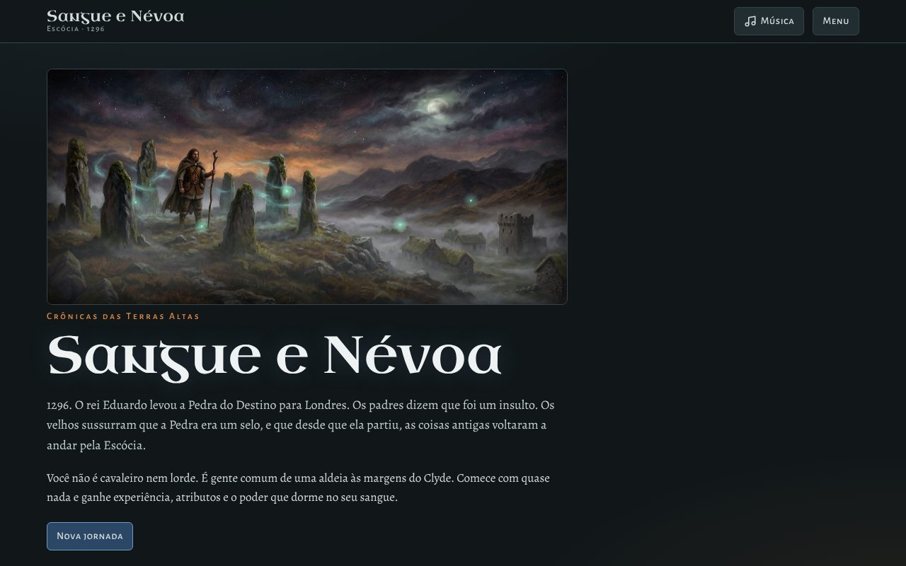
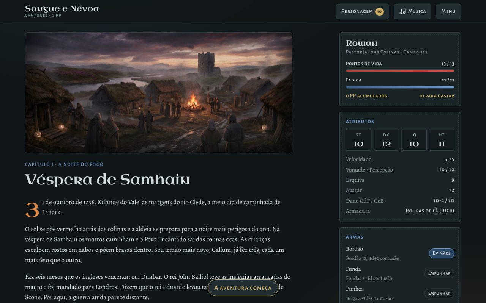
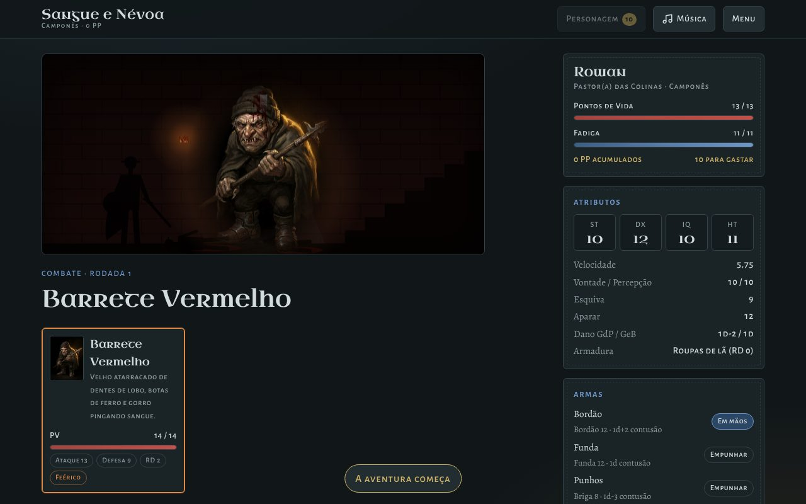
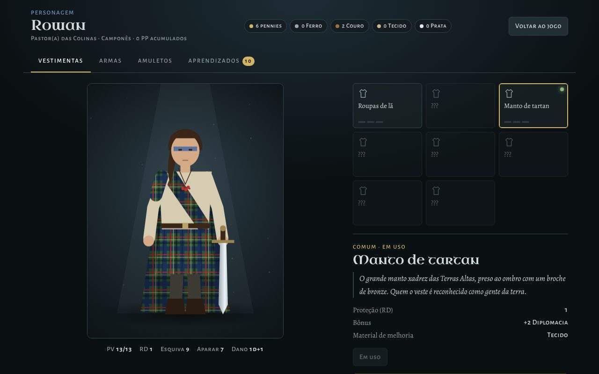

# Sangue e Névoa

**Crônicas das Terras Altas · Escócia, 1296–1314**

RPG narrativo para navegador, com regras inspiradas em GURPS (testes de 3d6, atributos e perícias compradas com pontos), ambientado nas guerras de independência da Escócia e misturado ao folclore escocês: kelpies, Baobhan Sìth, o Barrete Vermelho, o Sluagh e a Cailleach, a Velha do Inverno.

Você começa como gente comum de uma aldeia às margens do Clyde e atravessa dezoito anos de história, da noite em que a aldeia queima até a batalha de Bannockburn, ganhando experiência, equipamento e o poder que dorme no seu sangue.



## Como jogar

O jogo é um site estático, sem compilação nem servidor:

- **No computador:** baixe o repositório e abra o `index.html` no navegador.
- **Na internet:** ative o GitHub Pages em *Settings → Pages → Deploy from a branch → main / (root)*.
- **Com servidor local:** `npm start`.

O progresso é salvo automaticamente no navegador. A música começa no primeiro clique, porque os navegadores bloqueiam som automático.

## O que tem no jogo

- **6 capítulos e 221 cenas**, de 1296 a 1314, com escolhas que voltam capítulos depois.
- **4 finais** e um epílogo que conta o destino de cada personagem conforme as suas escolhas.
- **Sistema inspirado em GURPS:** atributos (ST, DX, IQ, HT), perícias com dificuldade, combate com defesa ativa, armadura (RD), tipos de dano, choque e testes de HT.
- **Progressão:** pontos de personagem, técnicas de combate, magia druídica em quatro círculos (Sangue Antigo), vestimentas, armas e amuletos que evoluem na forja até o nível Lendário.
- **Combate por turnos** com aliados, amuletos de uso ativo, frio, sede e regeneração dos inimigos.
- **117 pinturas** (97 cenas e 20 retratos de inimigos) com animações por cima: névoa, brasas, neve e vento.
- **Trilha sonora gerada em tempo real** (Web Audio API) em cinco climas, com vinhetas e efeitos.

| Cena | Combate | Personagem |
|---|---|---|
|  |  |  |

## Estrutura do projeto

```
├── index.html              Página do jogo (carrega os scripts em ordem)
├── css/style.css           Estilos
├── js/
│   ├── data/               Regras, equipamento, origens, bestiário e títulos
│   ├── core/               Mecânica, estado, validação de save, combate e fluxo entre cenas
│   ├── story/              Capítulos I a VI e a tabela de imagem e música de cada cena
│   ├── ui/                 Telas: cena, ficha, criação, evolução, personagem, menu, vento
│   ├── art/                Ilustração das cenas e retrato animado do herói
│   ├── audio/              Trilha sonora e efeitos
│   └── main.js             Inicialização
├── img/scenes/             Pinturas das cenas (21:9)
├── img/portraits/          Retratos dos inimigos (3:4)
├── docs/
│   ├── livro-do-jogador.md     Regras completas, capítulos e bestiário
│   ├── ARQUITETURA.md          Como o código funciona e como acrescentar conteúdo
│   ├── RELATORIO-DE-QUALIDADE.md  Revisão de código e testes de sabotagem, stress e segurança
│   └── analise-gemini.md       Revisão de game design feita com o Gemini
├── tests/                  História, sabotagem, stress e segurança (Playwright)
├── tools/                  Geração de imagens e consulta ao Gemini (Python); globais do ESLint
└── .github/workflows/      Integração contínua
```

Os scripts são arquivos JavaScript comuns, carregados em ordem pelo `index.html`, e não módulos ES. É uma escolha deliberada: módulos ES não funcionam quando a página é aberta direto do disco (`file://`), e o jogo deve abrir com dois cliques. Detalhes em [docs/ARQUITETURA.md](docs/ARQUITETURA.md).

## Desenvolvimento

Requer Node.js 20 ou mais novo.

```bash
npm install
```

```bash
npx playwright install chromium
```

| Comando | O que faz |
|---|---|
| `npm test` | Lint e os testes de história, sabotagem e segurança |
| `npm run test:stress` | Stress: 200 partidas completas, sessão longa, desempenho, 3.000 combates (cerca de 4 minutos) |
| `npm run lint` | ESLint em todo o projeto |
| `npm run format` | Formata o código com Prettier |

O teste de história valida o grafo (toda escolha leva a uma cena que existe, toda cena é alcançável e tem imagem e música) e joga partidas completas do começo ao fim. Os de sabotagem quebram o ambiente de propósito (saves corrompidos, armazenamento bloqueado, imagens fora do ar, cliques em rajada), e os de segurança tentam injeção de HTML, poluição de protótipo e acessos de rede indevidos. Resultados e detalhes: [docs/RELATORIO-DE-QUALIDADE.md](docs/RELATORIO-DE-QUALIDADE.md).

Para contribuir, veja [CONTRIBUTING.md](CONTRIBUTING.md). Para relatar uma falha de segurança, veja [SECURITY.md](SECURITY.md).

### Gerar imagens

As ilustrações foram feitas com o modelo de imagem do Gemini (Nano Banana Pro). Para gerar novas, ou refazer alguma:

```bash
pip install pillow
```

```bash
export GEMINI_API_KEY="sua-chave-do-google-ai-studio"
```

```bash
python3 tools/gerar_imagens.py aldeia retrato:kelpie
```

Os prompts ficam em `tools/prompts.py`. Sem argumentos, o script gera só as imagens que ainda não existem.

## História e lenda

O jogo segue os fatos das guerras de independência da Escócia: Stirling (1297), Falkirk (1298), a captura de William Wallace (1305), a coroação de Robert Bruce (1306) e Bannockburn (1314). Alguns episódios são lendas registradas séculos depois, como a ponte serrada, o pão virado e a aranha da caverna; o jogo e o [Livro do Jogador](docs/livro-do-jogador.md) avisam quando é o caso. O herói, sua família e a camada sobrenatural são ficção.

## Qualidade e segurança

- **Sem servidor e sem dados pessoais:** nada sai do navegador de quem joga.
- **Política de Segurança de Conteúdo**, escape de todo texto exibido e validação completa dos saves.
- **Testado sob sabotagem e stress:** 18 cenários de falha, 500 partidas completas, 3.000 combates, sessões longas sem vazamento de memória e animação a 60 quadros por segundo.
- **Integração contínua** com lint, testes e auditoria de dependências a cada envio.

## Créditos e licença

- **Código:** licença MIT (veja [LICENSE](LICENSE)).
- **Ilustrações:** geradas com o modelo de imagem do Google Gemini. Verifique os termos de uso do Gemini antes de usá-las comercialmente.
- **Fontes:** Uncial Antiqua, Alegreya e Alegreya Sans SC, via Google Fonts (SIL Open Font License).
- **Regras:** inspiradas em GURPS, da Steve Jackson Games. Este projeto não é afiliado nem endossado pela Steve Jackson Games.
